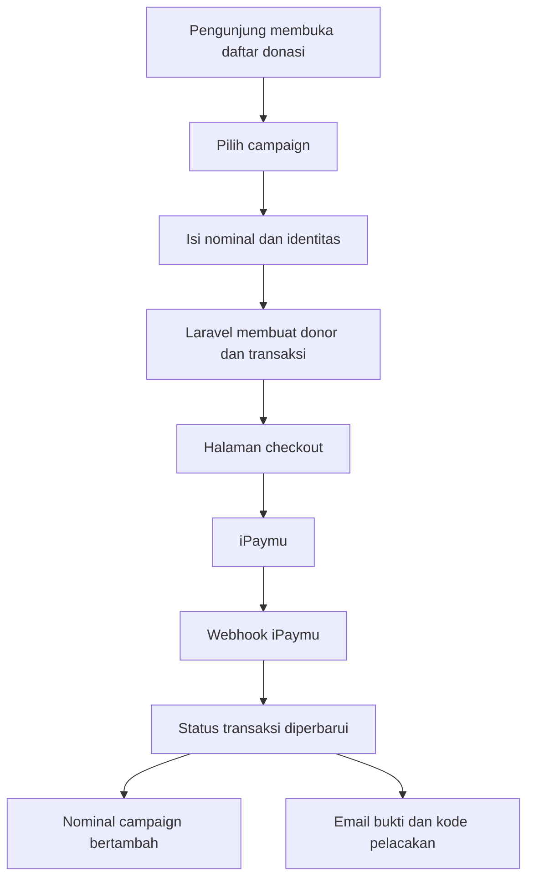
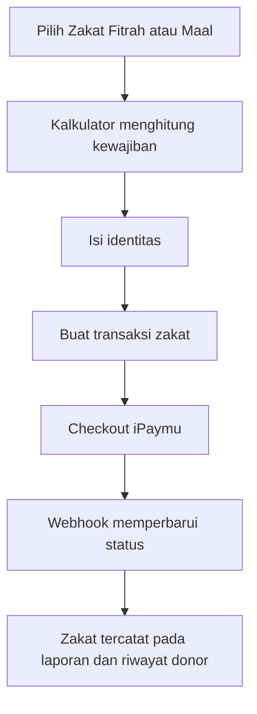
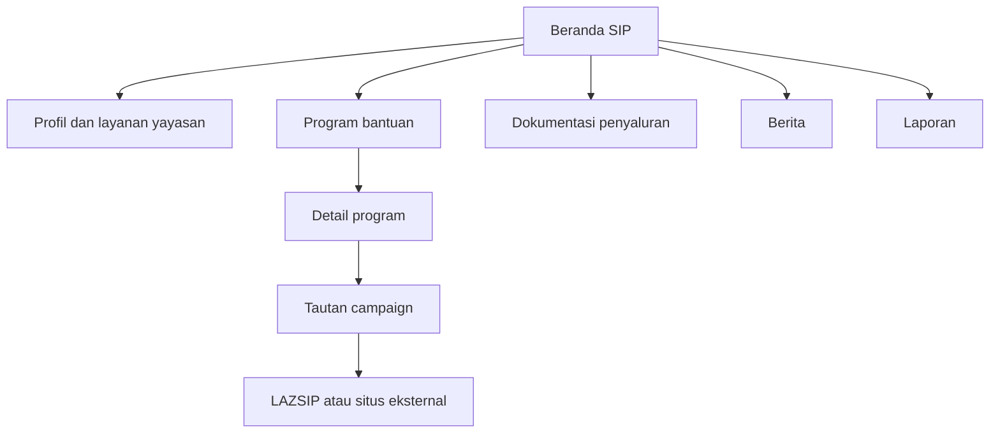
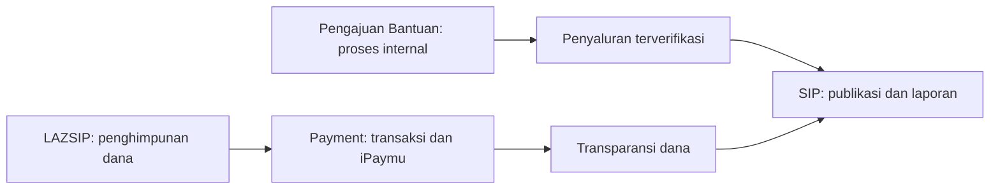

# Alur Modul LAZSIP dan SIP

Dokumen ini menjelaskan perilaku aplikasi yang sedang aktif setelah backend dipindahkan ke Laravel. Dokumen PRD lama masih memuat beberapa referensi Prisma dan arsitektur Next.js full-stack, sehingga alur di bawah disusun berdasarkan route, halaman, dan layanan yang benar-benar tersedia saat ini.

## Pembagian tanggung jawab

| Modul | Tanggung jawab utama |
|---|---|
| LAZSIP | Penghimpunan zakat dan donasi, campaign, donor, transaksi, program, serta data penerima manfaat |
| SIP | Portal publik yayasan, informasi program, dokumentasi penyaluran, berita, dan dokumen laporan |
| Payment | Checkout bersama, integrasi iPaymu, status transaksi, rekening tujuan, dan bukti pembayaran |
| Pengajuan Bantuan | Proses internal pengajuan, verifikasi, persetujuan, pencairan, dan penyerahan bantuan |

SIP berfungsi sebagai portal induk. LAZSIP menangani aktivitas penghimpunan dana. Modul Pengajuan Bantuan menangani proses penyaluran internal. Saat ini data ketiga modul belum tersinkron otomatis.

## Alur LAZSIP

### Donasi campaign



Donatur tidak perlu membuat akun. Form meminta nama serta minimal salah satu dari nomor WhatsApp atau email. Sistem membuat profil donor baru atau menghubungkan transaksi dengan profil yang sudah ada. Donatur juga dapat menyembunyikan nama dari tampilan publik.

Nominal campaign menggunakan kode unik untuk membantu rekonsiliasi. Setelah checkout dibuat, donatur memperoleh kode pelacakan seperti `LZS-XXXXXX`. Status lunas berasal dari verifikasi iPaymu, bukan dari halaman redirect.

### Pembayaran zakat



Zakat memakai layanan Payment yang sama dengan donasi, tetapi dicatat menggunakan jenis dana `zakat`. Donasi campaign dicatat sebagai `infak`.

### Status dan riwayat transaksi

LAZSIP menyediakan dua alur:

1. **Cek status transaksi:** pengunjung memasukkan kode pelacakan dan sistem menampilkan nominal, tujuan, serta status transaksi.
2. **Cek riwayat:** pengunjung memasukkan email. Riwayat dikirim ke alamat tersebut dan tidak ditampilkan langsung di browser agar email tidak dapat digunakan untuk mengintip transaksi orang lain.

### Program LAZSIP

Program mempunyai tipe informasi atau pendaftaran. Flow halaman yang aktif sekarang adalah:

```text
Pengunjung membuka program
→ Membaca deskripsi dan persyaratan
→ Klik Daftar Sekarang
→ Diarahkan ke formUrl eksternal
```

Backend juga mempunyai endpoint pendaftaran internal `POST /api/v1/lazsip/programs/{id}/apply` dan komponen `ApplyForm`. Namun halaman program saat ini menggunakan `formUrl` eksternal, sehingga daftar pendaftar internal tidak otomatis terisi dari halaman tersebut.

### Penerima manfaat dan penyaluran

Admin LAZSIP mengelola data penerima manfaat secara manual. Halaman publik menampilkan informasi yang diizinkan, sedangkan NIK, alamat lengkap, pekerjaan, penghasilan, dan tanggungan tetap privat.

Data penerima manfaat ini belum otomatis berasal dari modul Pengajuan Bantuan.

### Flow admin LAZSIP

Admin dengan akses modul dapat mengelola:

- campaign donasi dan riwayat nominal;
- pembayaran zakat;
- donor dan riwayat transaksi;
- transaksi dan status pembayaran;
- program serta status pendaftaran;
- pendaftar program;
- berita dan kegiatan;
- penerima manfaat;
- mitra;
- biaya payment;
- konten umum dan transparansi.

## Alur SIP

SIP adalah portal informasi yayasan. Modul ini tidak membuat transaksi dan tidak memproses pengajuan bantuan.

### Flow pengunjung



Halaman publik meliputi beranda, profil yayasan, layanan, program bantuan, dokumentasi penyaluran, berita, laporan, kontak, dan pertanyaan umum.

### Program bantuan SIP

Admin mengisi judul, slug, deskripsi, gambar, status pinned, dan `campaignUrl`. Tombol **Infaq untuk Program Ini** hanya muncul jika URL campaign tersedia.

Hubungan program SIP dengan LAZSIP masih berupa URL manual:

```text
Program SIP
→ campaignUrl
→ halaman donasi LAZSIP atau URL eksternal
```

Belum ada foreign key atau pemilih campaign LAZSIP. Perubahan URL campaign harus diperbarui manual pada data SIP.

### Dokumentasi penyaluran

Admin memasukkan judul, deskripsi, foto, lokasi, dan tanggal kegiatan. Data ini merupakan dokumentasi publik dan tidak mempunyai alur verifikasi, pencairan, atau status sudah/belum disalurkan.

### Laporan SIP

Laporan SIP adalah perpustakaan dokumen bulanan dan tahunan:

```text
Admin mengunggah PDF atau memasukkan URL laporan
→ Dokumen muncul pada halaman publik
→ Pengunjung membuka atau mengunduh laporan
```

Menu ini belum mencatat santunan rutin atau tidak rutin per penerima.

### Flow admin SIP

Admin dengan akses modul dapat mengelola:

- konten halaman utama;
- program bantuan;
- dokumentasi penyaluran;
- berita;
- laporan bulanan dan tahunan.

## Hubungan data saat ini

| Data | LAZSIP | SIP | Hubungan saat ini |
|---|---|---|---|
| Campaign donasi | Dikelola penuh | Menyimpan URL campaign | Manual |
| Transaksi | Tersedia | Tidak tersedia | Tidak terhubung |
| Zakat | Tersedia | Tidak tersedia | Tidak terhubung |
| Program | Program operasional atau pendaftaran | Informasi program yayasan | Data terpisah |
| Penerima manfaat | Data penerima individual | Tidak tersedia | Tidak tersinkron |
| Penyaluran | Penerima dan nominal bantuan | Dokumentasi kegiatan | Data terpisah |
| Laporan | Transparansi transaksi | Dokumen bulanan atau tahunan | Tidak tersinkron |
| Pengajuan Bantuan | Belum menjadi sumber | Belum menjadi sumber | Modul berdiri sendiri |

## Masalah flow yang ditemukan

1. Program SIP terhubung ke campaign LAZSIP melalui URL manual.
2. Program LAZSIP mempunyai form eksternal pada UI dan endpoint pendaftaran internal yang tidak dipakai halaman aktif.
3. Data penyaluran dicatat terpisah pada LAZSIP dan SIP.
4. Hasil modul Pengajuan Bantuan belum otomatis menjadi penerima manfaat atau dokumentasi penyaluran.
5. Laporan SIP belum mempunyai pencatatan santunan rutin dan tidak rutin.
6. Endpoint transaksi legacy masih hidup berdampingan dengan checkout Payment yang baru.

## Arah integrasi yang disarankan



- LAZSIP tetap menjadi pemilik campaign, donor, zakat, dan transaksi.
- Pengajuan Bantuan menjadi pemilik proses calon penerima sampai penyerahan.
- SIP menampilkan program, dokumentasi, dan laporan publik yang telah disetujui.
- Program SIP sebaiknya memilih campaign LAZSIP berdasarkan ID, bukan URL bebas.
- Penyaluran yang selesai sebaiknya dapat dipublikasikan ke SIP melalui tindakan admin yang eksplisit.
- Data pribadi tidak boleh disalin ke konten publik; hanya field yang telah disetujui untuk publikasi yang dikirim.

