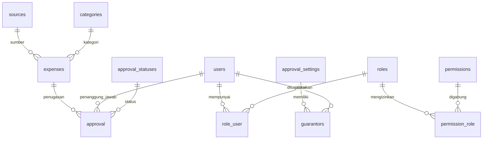

# Rancangan data modul Keuangan

Status: rancangan untuk implementasi berikutnya. Belum ada tabel dibuat atau data
keuangan diimpor ke database SIPERP.

## Relasi lama

Tidak ada FK dari `approval` ke `approval_settings`, sehingga aturan yang membuat
penugasan lama tidak dapat ditetapkan kembali dengan pasti setelah aturan diedit.
Tidak ada FK `expenses.created_by`; pengguna pembuat tidak diketahui dari tabel ini.

## Kamus 15 tabel sumber

Semua tabel menggunakan InnoDB dan utf8mb4_unicode_ci. PK bisnis memakai BIGINT
UNSIGNED; `password_resets` tidak memiliki kolom ID. Definisi lengkap dan tindakan
migrasinya diringkas pada [pemetaan-tabel.csv](pemetaan-tabel.csv).

| Tabel | Kolom relevan | Makna dan batas |
| --- | --- | --- |
| `expenses` | id, source_id, category_id, recipient VARCHAR(255), amount BIGINT UNSIGNED, description TEXT, created_at, updated_at | Pengeluaran/catatan, bukan bukti bank; tidak ada creator, paid_at atau payment status |
| `approval` | id, expense_id, user_id, approval_status_id, note VARCHAR(255), timestamps | Penugasan dan keputusan terakhir per akun; bukan ledger riwayat revisi |
| `approval_statuses` | id, name, timestamps | 1 Waiting, 2 Approved, 3 Rejected |
| `approval_settings` | id, from_amount, to_amount (BIGINT UNSIGNED), timestamps | Rentang nominal inklusif; tidak memuat urutan tahapan |
| `guarantors` | id, approval_setting_id, user_id, timestamps | Daftar penanggung jawab aturan; bukan data penerima uang |
| `sources` | id, name VARCHAR(255), timestamps | Label sumber dana, tidak memiliki nomor rekening/saldo |
| `categories` | id, name VARCHAR(255), timestamps | Kategori pengeluaran |
| `users` | id, name, username, email, email_verified_at, password, remember_token, timestamps | Identitas lama; migrasi dikendalikan Core |
| `roles` | id, slug, name, timestamps | Peran lokal aplikasi lama; label Super Admin bukan global ERP |
| `permissions` | id, slug, name, timestamps | Katalog 25 izin |
| `permission_role` | id, permission_id, role_id, timestamps | Gabungan permission per role |
| `role_user` | id, role_id, user_id, timestamps | Akun dapat memiliki lebih dari satu role |
| `migrations` | id INT, migration, batch | Riwayat schema aplikasi lama; bukan milik SIPERP |
| `failed_jobs` | id, uuid, connection, queue, payload, exception, failed_at | Data teknis; dapat mengandung data privat, tidak dipindahkan sebagai bisnis |
| `password_resets` | email, token, created_at | Token reset lama; tidak dipindahkan ke sesi/identitas Core |

FK sumber tidak mendefinisikan cascade delete pada bisnis; prefix indeks yang
mengandung kata foreign bukan bukti adanya cascade. Guard penghapusan pada controller
juga harus dipetakan ke policy baru.

## Tabel target yang diusulkan

Identitas dan autentikasi memakai `users`, `module_access`, dan layanan Core yang
sudah ada. Semua tabel bisnis baru memakai prefix `keuangan_` agar tidak bertabrakan
dengan tabel Core/Payment/Bantuan.

| Target | Isi utama | Invariant |
| --- | --- | --- |
| `keuangan_sources` | id baru, nama, archived_at, timestamps, provenance | Source yang direferensikan tidak dihapus permanen |
| `keuangan_categories` | id baru, nama, archived_at, timestamps, provenance | Nama historis tidak dinormalisasi/merge otomatis |
| `keuangan_expenses` | id, source_id, category_id, recipient, amount, description, created_by nullable, version, origin, timestamps | Nominal integer rupiah; created_by lama tetap unknown; arsip/pembatalan diaudit |
| `keuangan_approval_rules` | id, min_amount, max_amount, active, version, timestamps | Tidak overlap; kedua batas inklusif |
| `keuangan_rule_approvers` | rule_id, Core user_id | Unik per rule/user; tidak menyiratkan urutan approval |
| `keuangan_approvals` | id, expense_id, assigned_user_id, decision, note, rule_snapshot nullable, version, legacy_updated_at | Unik expense/user; keputusan hanya pemilik yang berizin; snapshot aturan lama unknown |
| `keuangan_approval_events` | approval_id, actor_id nullable, action, before/after, reason, recorded_at, origin | Append-only; event import bukan keputusan baru |
| `keuangan_expense_events` | expense_id, actor_id nullable, version, perubahan, reason, recorded_at, origin | Audit perubahan setelah modul diterapkan; tidak mengarang histori sebelum import |
| `keuangan_roles` | id, slug, label, archived_at | Hanya role modul, tidak mengubah Superadmin/Core role global |
| `keuangan_permissions` | id, slug, label | Allowlist capability Keuangan; bukan permission arbitrer lintas modul |
| `keuangan_permission_role` | role_id, permission_id | Unik per pasangan; mempertahankan 55 grant dari snapshot |
| `keuangan_role_user` | role_id, Core user_id | Unik per pasangan; mendukung gabungan role lama |
| `keuangan_staff` | Core user_id unik, primary_role_at_grant, grant_revision, status | Grant tidak boleh tetap efektif jika akses/peran Core dicabut/diganti |
| `keuangan_legacy_links` | origin_source, legacy_table, legacy_id string, target_id, checksum, import_batch_id | Unik sumber/tabel/ID; identitas sumber stabil antar dump |
| `keuangan_import_batches` | source_hash, schema_version, counts, status, checkpoint, actor_id, timestamps | Checkpoint dan audit importer, bukan menyimpan SQL/password |

Daftar ini merupakan usulan schema, belum keputusan migration final. Nama dan tipe
ID baru mengikuti model/Core SIPERP. Historical labels yang dibutuhkan hanya
tersimpan di database privat dengan policy akses; tidak ditaruh pada fixture repo.

## Pemetaan kolom inti

| Sumber | Target/proses | Perlakuan |
| --- | --- | --- |
| expenses.id | legacy_links + expenses.id baru | ID lama dipertahankan sebagai string referensi; tidak memaksa ID integer ke Core |
| expenses.source_id/category_id | FK melalui mapping master | Tidak dicari berdasarkan kemiripan nama |
| expenses.recipient/description | recipient/description | Simpan nilai asli; tidak mengubah ejaan atau membagikan ke Core Contact otomatis |
| expenses.amount | amount BIGINT UNSIGNED | Tidak dibagi/dikali, tidak float, tidak dibulatkan |
| expenses.created_at/updated_at | waktu historis | SQL diekspor dalam UTC; UI lama memakai Asia/Jakarta. Simpan instan UTC satu kali |
| tidak ada created_by | created_by = null, origin = legacy | Bukan user import, bukan approver, bukan akun yang kebetulan pertama |
| approval.user_id | assigned_user_id melalui mapping Core | Wajib mapping akun eksplisit, bukan mencocokkan nama |
| approval.approval_status_id | waiting / approved / rejected | Mapping eksplisit 1/2/3; status lain menghentikan dry-run |
| approval.note | note | Pertahankan, termasuk catatan yang tertinggal setelah status pernah diubah |
| approval.updated_at | legacy_updated_at | Waktu ubah terakhir, belum tentu bukti waktu keputusan pertama |
| approval_settings + guarantors | rules + rule_approvers | Snapshot konfigurasi kini, bukan pembuktian aturan historis |
| users.password | Core onboarding terkontrol | Tidak ditulis ulang ke akun Core yang sudah ada; hash tidak masuk CSV/report |
| users.username | alias identitas lama privat | Bukan langsung kode Core; reserved prefix/normalisasi/collision diperiksa Core |
| remember_token/password_resets | tidak dimigrasi | Semua orang login melalui Core; tidak membawa sesi lama |

Teks sumber VARCHAR(255) harus diperiksa terhadap batas target. Bila terlalu panjang,
tolak/karantina dan laporkan; jangan truncate diam-diam. Nama/email sama tidak
membuktikan akun sama. Field email_verified_at lama juga tidak otomatis menjadi
verifikasi identitas/otorisasi lintas modul.

## Nominal dan jembatan ke ledger

Sumber menyimpan nominal dan batas aturan dalam BIGINT UNSIGNED, sedangkan
`core_expenses.amount` dalam checkout saat ini berupa signed INTEGER dan endpoint
Core membatasi nominal maksimal 2.147.483.647. Salin langsung dapat overflow atau
memaksa hilangnya informasi. Modul harus memvalidasi rentang database dan
mengirim nilai rupiah sebagai string desimal ketika melewati batas aman JavaScript.
Tidak boleh memakai float untuk agregasi/rekonsiliasi.

`keuangan_sources` tidak sama dengan `payment_destination_accounts`.
Bila integrasi ledger dibangun kemudian, gunakan mapping rekening eksplisit dan
link satu-ke-satu/idempotency key ke Core Expense. Tidak ada posting otomatis dari
status approved; tabel `keuangan_payment_links`/resource pembayaran baru hanya
boleh dirancang setelah proses pembayaran aktual dan bukti disepakati.

## Kualitas data dan pemeriksaan sebelum import

Dalam snapshot yang diperiksa, tidak ditemukan FK yatim, pasangan pivot duplikat,
nominal pengeluaran nol, timestamp transaksi/approval kosong, aturan overlap,
atau aturan tanpa guarantor. Ini hasil snapshot, bukan jaminan dump berikutnya.
Terdapat transaksi tanpa assignment. Rincian hitungan privat ada pada laporan audit.

Sebelum impor ulang: periksa seluruh kriteria tersebut, transaksi di luar cakupan
aturan kini, enum status, nilai integer, panjang teks, collision identitas, duplikasi
nama master, dan akun approver yang tidak memperoleh akses approval. Jangan
memperbaiki data sumber atau menebak penugasan hanya agar importer lolos.
